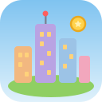
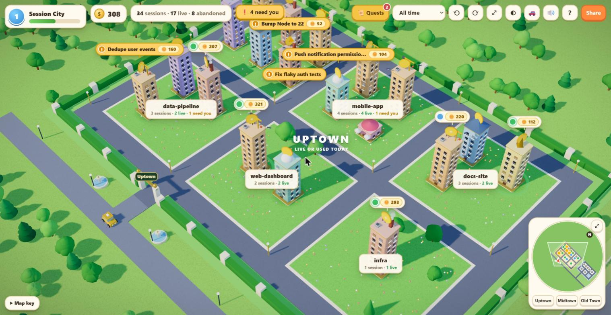
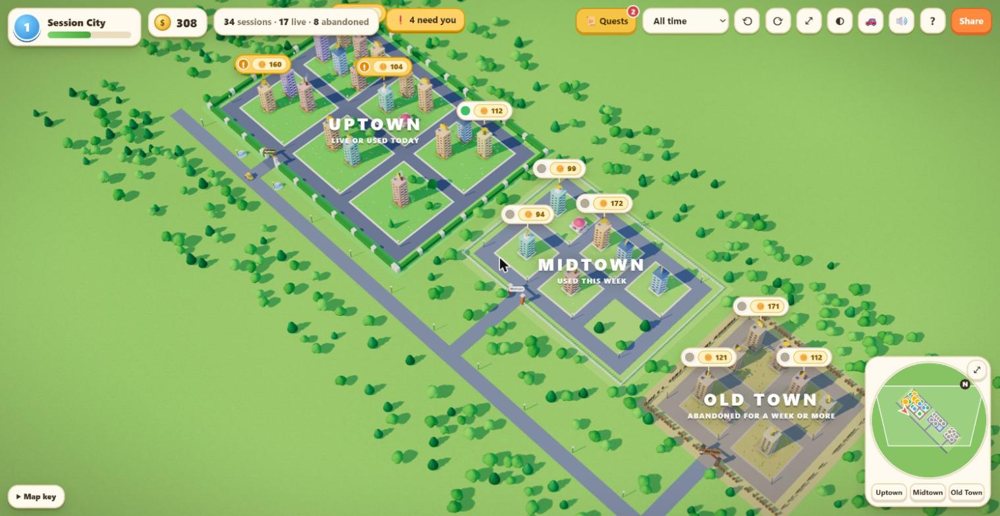
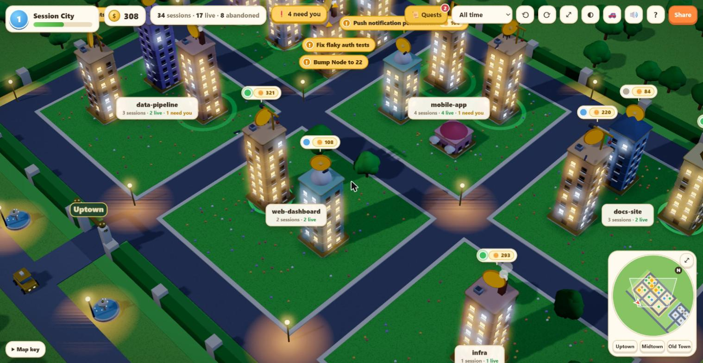
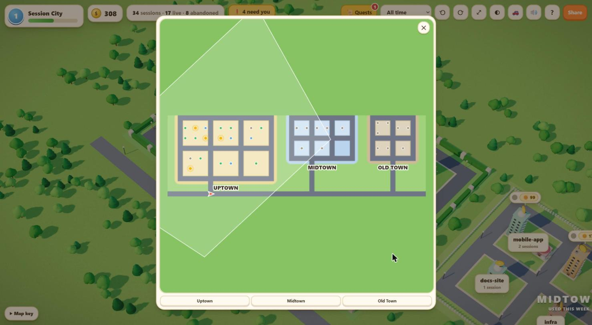
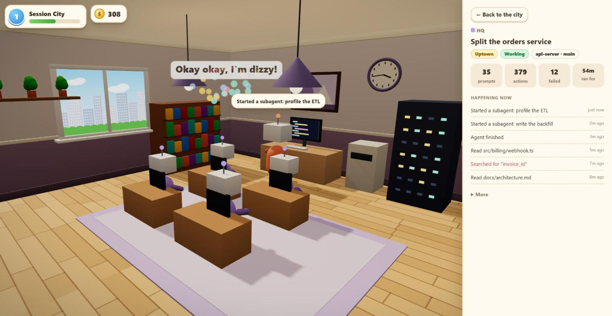
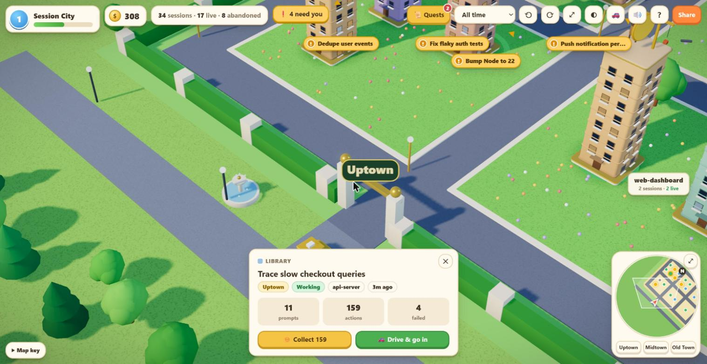
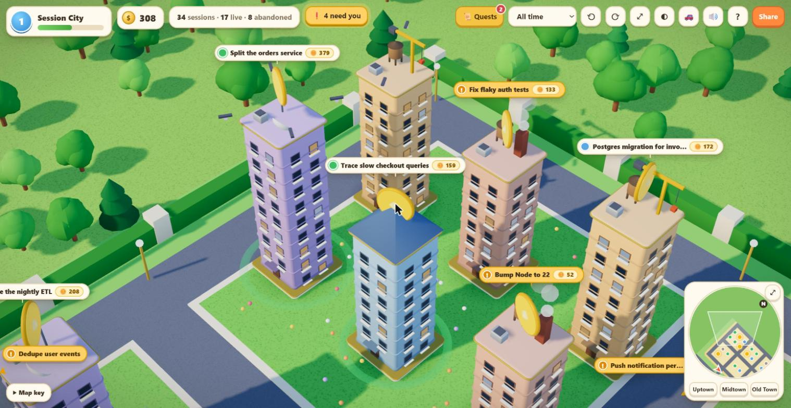
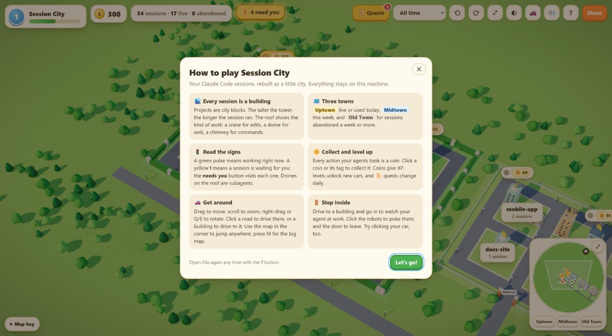

<div align="center">



# Session City

**Your Claude Code sessions, rebuilt as a little 3D city you can drive around.**

Every session is a building · every project a block · every action a coin

[](https://github.com/vibhusharma101/session-city/releases)
[](https://github.com/vibhusharma101/session-city/stargazers)
[](LICENSE)


[**Quick start**](#-quick-start) · [**Features**](#-features) · [**How to play**](#-how-to-play) · [**Privacy**](#-privacy) · [**FAQ**](#-faq)



</div>

## 💡 Why

If you run Claude Code all day, you end up with dozens of sessions across a dozen projects. Which one is still working? Which one is stuck waiting for you? What did you abandon last week?

Session City turns that list into a place. Live sessions glow in **Uptown**, the ones that need you wave a yellow **!**, and the ones you forgot crumble in **Old Town**. You can collect coins, level up, unlock cars, and step inside any building to watch your agent at work.

## 🚀 Quick start

You need [Claude Code](https://claude.com/claude-code) and Node 18 or newer.

**As a Claude Code plugin** (recommended). Inside Claude Code, run:

```
/plugin marketplace add vibhusharma101/session-city
/plugin install session-city@session-city
/session-city:city
```

Your city opens at `http://127.0.0.1:4747`. Next time, `/session-city:city` is all you need.

**Or from any terminal:**

```
npx github:vibhusharma101/session-city
```

**Just curious?** Run it and open `http://127.0.0.1:4747/?demo` for a sample city, or `?demo=busy` for a crowded one.

The server runs in the background and stops by itself a few minutes after you close the tab.

## ✨ Features

<table>
<tr>
<td width="50%" valign="top">



**🏘️ Three towns.** Live and today's sessions in posh Uptown, this week's in Midtown, and the abandoned ones in a crumbling Old Town.

</td>
<td width="50%" valign="top">



**🌙 Day and night follow your clock.** Windows of working sessions glow at night, and street lamps light the roads.

</td>
</tr>
<tr>
<td valign="top">



**🗺️ A map like an open-world game.** A radar in the corner turns with you. Press **M** for the big map, then click anywhere to go there.

</td>
<td valign="top">



**🤖 Step inside.** Watch your agent walk to whatever it's doing right now. Click the robots to poke them, and keep clicking for a dance.

</td>
</tr>
<tr>
<td valign="top">



**🪙 Play.** Every action your agents took is a coin. Collect them, level up, unlock cars, and finish daily quests.

</td>
<td valign="top">



**🏙️ Readable at any zoom.** Labels work like a map: town names far out, project names in between, and session titles up close. Labels never pile on top of each other.

</td>
</tr>
</table>

**Also:**
- **📖 Session stories:** every prompt, reply and action, with credentials masked.
- **📸 Shareable postcards:** your city and stats in one image.
- **✅ Just-finished highlights:** when a session finishes its turn, its building gets a green beam, you get a toast and a chime, and the tab title counts it. **✅ finished** takes you to it and shows which folder its terminal is in.
- **❗ Needs-you alerts:** off-screen sessions that are waiting for you point at themselves from the screen edge.
- **🎓 Built-in how-to-play guide:** opens on your first visit, and any time with **?**.

## 🎮 How to play



| Do this | How |
|---|---|
| Look around | drag to pan, scroll to zoom, right-drag or **Q / E** to turn, **WASD** or arrow keys to pan, **⤢** for the whole city |
| Find your way | the round map in the corner; click it to go there, use the town buttons, or press **M** for the big map |
| Visit a session | click its building or its tag: your car drives over and the card opens; **Go inside** enters the room |
| Collect coins | click the coin above a building, or **Collect** on its card |
| Find who needs you | the yellow **❗ needs you** button visits each waiting session in turn |
| See what just finished | the green **✅ finished** button; the card says which folder its terminal is in |
| Have fun | poke the robots inside a building; click your car to make it hop |
| Get help | **?** opens the how-to-play guide |

<details>
<summary><b>More controls</b></summary>

| Do this | How |
|---|---|
| Level up | coins and quests give XP; levels 2 to 6 each unlock a new car (🚗 to switch) |
| Daily quests | **📜 Quests**: three goals a day, like answering a session that needs you or exploring Old Town |
| Day or night | follows your clock; ◐ pins day or night until you reload |
| Sound | small synthesized blips; 🔊 mutes them |
| Leave a building | the EXIT door, **← Back to the city**, or Escape |

Coins, XP and quests are kept in your browser only.

</details>

<details>
<summary><b>Reading the city</b></summary>

| You see | It means |
|---|---|
| Building height | how many turns the session ran |
| Lit windows, a green ripple on the ground | the session is working right now |
| A bouncing yellow **!** tag, or an arrow at the screen edge | the session is waiting for you |
| A green beam of light and a **✓ done** tag | the session just finished its turn and Claude Code is still open: check that terminal (the newest one or two you haven't looked at yet) |
| A spinning gold coin, and its amount on the tag | actions you haven't collected yet |
| Drones circling the roof | subagents the session dispatched |

The roof tells you what kind of work the session mostly did:

| Building | Roof | Kind of work |
|---|---|---|
| **Workshop** | crane | editing code |
| **Library** | pitched roof | reading and searching |
| **Factory** | chimney | running commands |
| **Observatory** | dome | web and browser work |
| **HQ** | antenna and dish | dispatching subagents |
| **Exchange** | gold spire | MCP tools |
| **Café** | umbrellas | mostly conversation |

</details>

## 📖 Session stories

**📖 Story** (on a building's card, or inside it) opens the whole session as a readable page, built on your machine from its transcript. It shows:
- every prompt you gave, with Claude's replies
- each action Claude took (files read and edited, commands run, searches, subagents), with failures in red
- the list of files changed

Anything that looks like a credential (API keys, tokens, private keys, `password=…`, `user:pass@` URLs) is masked, so the page is safe to screen-share. Masking is pattern-based, so check before sharing anything sensitive.

## 📸 Share your city

**Share** makes a postcard of your city with your stats on it. Project names are hidden unless you turn them on. Download it, copy it, or post it to X or LinkedIn. The image is made on your machine and only goes where you put it. Tag it **#MySessionCity**.

## 🔒 Privacy

Session City runs entirely on your machine:

- The server binds to `127.0.0.1` only and makes no outbound requests. Three.js is bundled, so the page loads nothing from the internet either.
- The city uses only an allowlist of metadata (counts, tool names, timestamps, title). `test/scan.test.js` checks that prompt text, tool inputs and tool outputs never reach it.
- The session story reads the full transcript, but only when you open it, and only on `127.0.0.1`.
- The server writes nothing. Your coins and quests live in your browser's local storage.

## ❓ FAQ

<details>
<summary><b>Does it use tokens or call any AI?</b></summary>

No. It reads the session files Claude Code already keeps in `~/.claude/projects` and draws them. There are no model calls and no network requests.
</details>

<details>
<summary><b>Will it slow down Claude Code?</b></summary>

No. It's a separate small local server that only reads files. Close the tab and it stops by itself.
</details>

<details>
<summary><b>Can I see it without my own sessions?</b></summary>

Yes. Open `http://127.0.0.1:4747/?demo` for a sample city, or `?demo=busy` for a crowded one with 34 sessions.
</details>

<details>
<summary><b>Where does my progress live?</b></summary>

In your browser's local storage, on this machine. Nothing is uploaded, and there is no account.
</details>

<details>
<summary><b>Something's wrong</b></summary>

| Problem | Fix |
|---|---|
| "No sessions in this view" | Run a Claude Code session first, or set the time range to **All time**. Sessions are read from `~/.claude/projects`. |
| Your Claude Code data lives elsewhere | Set `CLAUDE_CONFIG_DIR` to that folder. |
| Port 4747 is taken | It moves to the next free port and prints the URL; or pass `--port 5000`. |
| A blank page | The city needs WebGL2, which any recent Chrome, Edge, Firefox or Safari has. Check that hardware acceleration is on. |

</details>

## ⚙️ Options

```
session-city --port 5000    # pick a port (falls back to the next free one)
session-city --no-open      # don't open the browser
session-city --detach       # run in the background (what /session-city:city uses)
```

## 🛠️ Development

```
npm start                   # serve your city
npm test                    # node --test, no dependencies
claude --plugin-dir .       # try the plugin without installing it
claude plugin validate .
```

No npm dependencies; requires Node 18+. [Three.js](https://threejs.org) (MIT) is vendored in `public/three.js` and `public/three-core.js`. Add `?debug` to the URL to get `window.sc` (the city, game state and app state) in devtools.

**Contributing.** Issues and PRs are welcome. `main` is released, `develop` is integration, and every change goes on its own branch with a PR into `develop`. Share your city with **#MySessionCity**; it might end up here.

## ⭐ Star history

<a href="https://star-history.com/#vibhusharma101/session-city&Date">
  
</a>

## 🙏 Acknowledgements

- [Three.js](https://threejs.org) for the 3D.
- [threejs-game-skills](https://github.com/majidmanzarpour/threejs-game-skills) for inspiration on game feel.

## 📄 License

[MIT](LICENSE). Not affiliated with Anthropic.

<div align="center">

**If your city made you smile, a ⭐ helps other people find it.**

</div>
