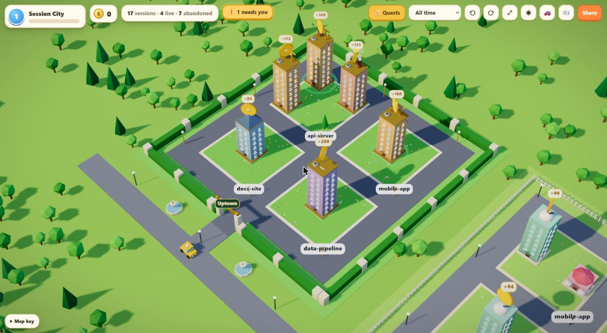
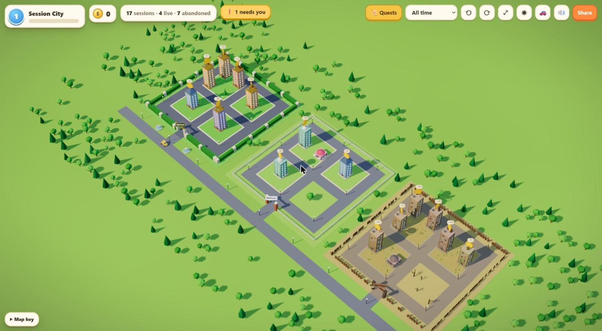
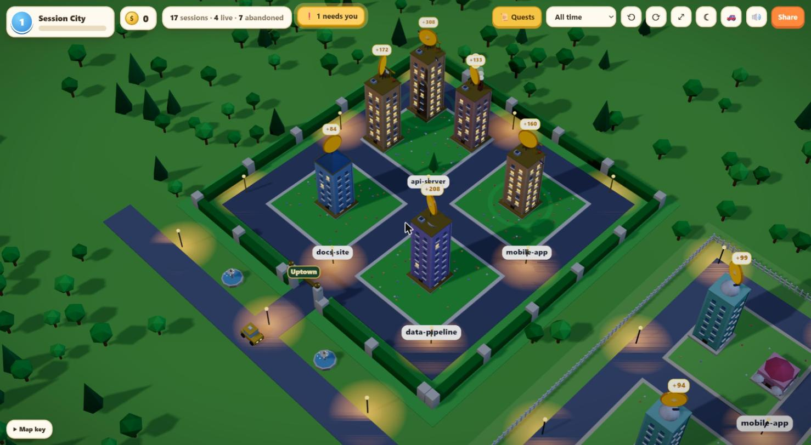
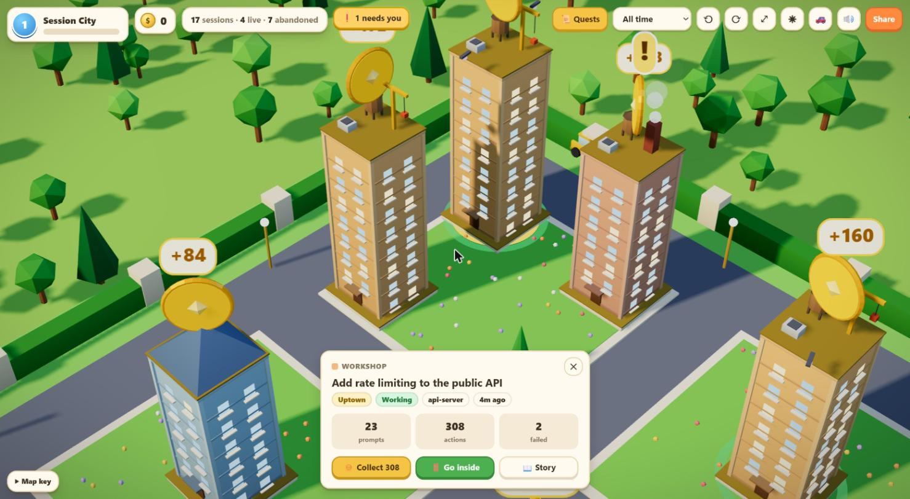
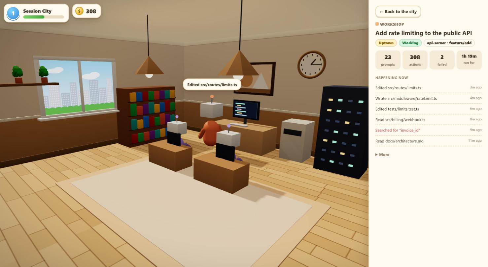

# Session City

**Your Claude Code sessions as a little 3D city you can drive around.**
Every session is a building, every project a block, every action a coin. It runs on your machine and nothing leaves it.

[](https://github.com/vibhusharma101/session-city/releases)
[](LICENSE)




## Get your city in 30 seconds

You need [Claude Code](https://claude.com/claude-code) and Node 18 or newer.

**As a Claude Code plugin** (recommended). Inside Claude Code, run:

```
/plugin marketplace add vibhusharma101/session-city
/plugin install session-city@session-city
/session-city:city
```

Your city opens in the browser at `http://127.0.0.1:4747`. Next time, `/session-city:city` is all you need.

**Or from any terminal:**

```
npx github:vibhusharma101/session-city
```

The server runs in the background and stops by itself a few minutes after you close the tab.

## What you'll see

### Three colonies: busy, quiet and abandoned

Sessions move into walled neighbourhoods depending on when you last touched them:

| Colony | Who lives there | Looks like |
|---|---|---|
| **Uptown** | live sessions, or anything used in the last 24 hours | hedges, a gold gate, fountains, flower beds |
| **Midtown** | sessions used this week | white picket fence, tidy streets |
| **Old Town** | sessions untouched for a week or more | broken fence, dry grass, dead trees, boarded-up windows |

Inside each colony, every project gets its own block.



### Day and night follow your clock

Open it at night and the windows of live sessions glow and the street lamps come on.

| Day | Night |
|---|---|
|  |  |

### Click any building

The card shows what the session was about, how busy it was, and the coins waiting for you.



### Step inside

You stand inside the session's room: floorboards, lamps, a clock with your real time, and a window onto the city that turns to night when you do. The room is furnished with the work the session did. The robot agent walks to whatever it is doing right now, with its latest action in a speech bubble. Subagents work at the desks, and the side panel shows the live activity feed. Drag to look around.



## How to play

| Do this | How |
|---|---|
| Look around | drag to pan, scroll to zoom, right-drag or **Q / E** to turn a quarter, **WASD** or arrow keys to pan, **⤢** for the whole city |
| Visit a session | click its building: your car drives over and the card opens; **Go inside** enters the room |
| Collect coins | click the coin above a building (one coin for every action an agent took) |
| Level up | coins and quests give XP; levels 2 to 6 each unlock a new car (🚗 to switch) |
| Daily quests | **📜 Quests**: three goals a day, like answering a session that needs you or exploring Old Town |
| Find who needs you | the yellow **❗ needs you** button flies you to a session waiting for your input |
| Day or night | follows your clock; ◐ pins day or night until you reload |
| Sound | small synthesized blips; 🔊 mutes them |
| Leave a building | the EXIT door, **← Back to the city**, or Escape |

Coins, XP and quests are kept in your browser only.

## Reading the city

| You see | It means |
|---|---|
| Building height | how many turns the session ran |
| Lit windows, a green ripple on the ground | the session is working right now |
| A bouncing yellow **!** | the session is waiting for you |
| A gold coin with a number | actions you haven't collected yet |
| Drones circling the roof | subagents the session dispatched |

The roof tells you what kind of work the session mostly did:

| Building | Roof | Kind of work |
|---|---|---|
| **Workshop** | crane | editing code |
| **Library** | pitched roof | reading and searching |
| **Factory** | chimney | running commands |
| **Observatory** | dome | web and browser work |
| **HQ** | antenna and dish | dispatching subagents |
| **Exchange** | gold spire | MCP tools |
| **Café** | umbrellas | mostly conversation |

## Read what happened in a session

**📖 Story** (on the card or inside a building) opens the whole session as a readable page, built on your machine from its transcript:

- every prompt you gave, in order, with Claude's replies
- each action Claude took (files read and edited, commands run, searches, subagents), with failures in red
- the list of files changed

Anything that looks like a credential (API keys, tokens, private keys, `password=…`, `user:pass@` URLs) is masked, so the page is safe to screen-share. Masking is pattern-based, so check before sharing anything sensitive.

## Share your city

**Share** makes a postcard from a snapshot of your city with your stats on it. Project names are hidden unless you turn them on. Download it, copy it, or post it to X or LinkedIn. The image is made on your machine and only goes where you put it. Tag it **#MySessionCity**.

## Privacy

Session City runs entirely on your machine:

- The server binds to `127.0.0.1` only and makes no outbound requests. Three.js is bundled, so the page loads nothing from the internet either.
- The city uses only an allowlist of metadata (counts, tool names, timestamps, title). `test/scan.test.js` checks that prompt text, tool inputs and tool outputs never reach it.
- The session story reads the full transcript, but only when you open it, and only on `127.0.0.1`.
- The server writes nothing. Your coins and quests live in your browser's local storage.

## Troubleshooting

| Problem | Fix |
|---|---|
| "No sessions in this view" | Run a Claude Code session first, or set the time range to **All time**. Sessions are read from `~/.claude/projects`. |
| Your Claude Code data lives elsewhere | Set `CLAUDE_CONFIG_DIR` to that folder. |
| Port 4747 is taken | It moves to the next free port and prints the URL; or pass `--port 5000`. |
| A blank page | The city needs WebGL2, which any recent Chrome, Edge, Firefox or Safari has. Check that hardware acceleration is on. |
| Want to see it without your own sessions | Open `http://127.0.0.1:4747/?demo` for a made-up sample city. |

## Options

```
session-city --port 5000    # pick a port (falls back to the next free one)
session-city --no-open      # don't open the browser
session-city --detach       # run in the background (what /session-city:city uses)
```

## Development

```
npm start                   # serve your city
npm test                    # node --test, no dependencies
claude --plugin-dir .       # try the plugin without installing it
claude plugin validate .
```

No npm dependencies; requires Node 18+. [Three.js](https://threejs.org) (MIT) is vendored in `public/three.js` and `public/three-core.js`. Add `?demo` to the URL for sample data, and `?debug` to get `window.sc` (the city, game state and app state) in devtools.

Contributions are welcome. Branches: `main` is released, `develop` is integration, and every change goes on its own branch with a PR into `develop`.

## License

[MIT](LICENSE). Not affiliated with Anthropic.

If your city made you smile, a ⭐ helps other people find it.
